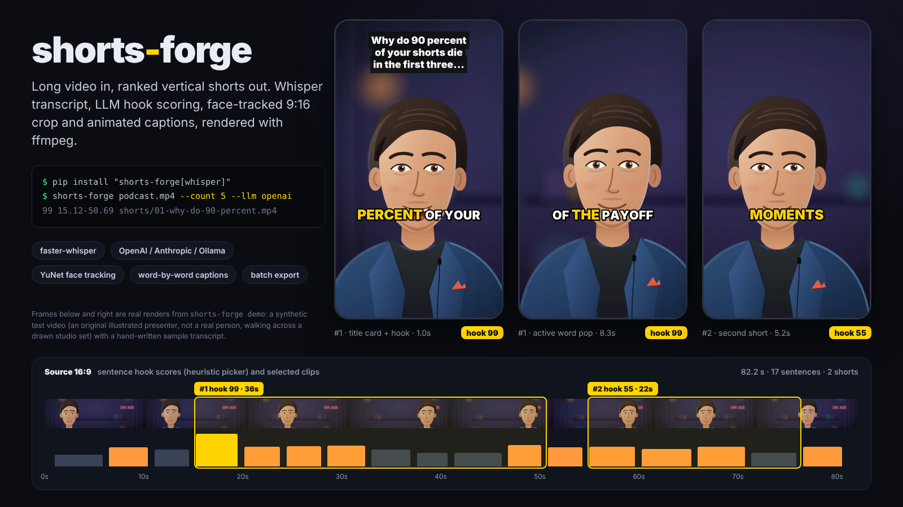
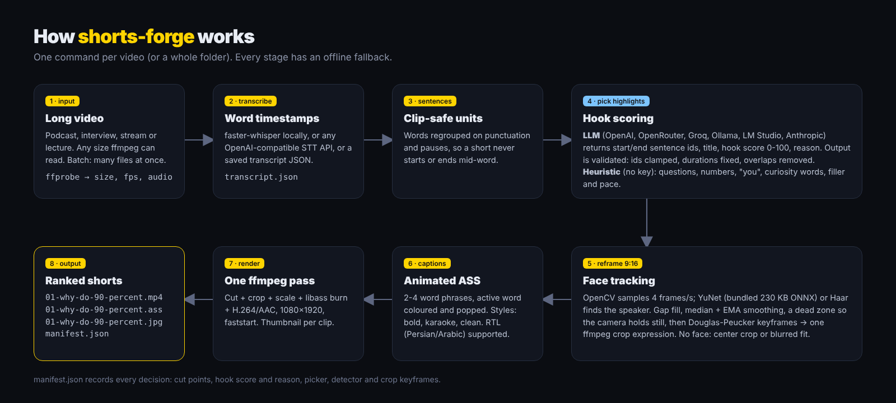

# shorts-forge

**Turn long videos into viral vertical shorts with AI.** It transcribes with Whisper, has an LLM pick the moments with the strongest hooks, tracks the speaker's face to crop 9:16, burns in animated word-by-word captions and exports a batch of ranked clips. It's an open-source, self-hosted alternative to Opus Clip-style tools.

[](https://github.com/mohammadhadijavidi/shorts-forge/actions/workflows/ci.yml)
[](LICENSE)
[](pyproject.toml)



<sub>Everything in this image is a real render from `shorts-forge demo`. The source is a synthetic test video: an original illustrated presenter (vector art drawn for this project, not a photo of any real person) walking across a drawn studio set, with a hand-written **sample** transcript. The bundled YuNet detector tracks the illustrated face in every sampled frame. The hook scores come from the offline heuristic picker, not from an LLM.</sub>

## Why

A podcast episode or a livestream contains ten good shorts. Finding them, cutting them, reframing them for a phone and captioning them by hand takes hours. Hosted AI clippers handle it, but they charge per minute, keep your footage on their servers and won't tell you why they picked a clip.

Several open-source "YouTube Shorts generator" scripts already exist. Most of them are a single notebook that's tied to one paid API, crops a static center (or the face in each frame, which jitters) and gives you no clean way to batch or check the results. shorts-forge is meant to be the dependable version:

- **It runs fully local if you want.** It uses faster-whisper plus Ollama or LM Studio, so no video leaves your machine. Any OpenAI-compatible API or Anthropic works too, and there's an offline heuristic picker that needs no model at all.
- **The camera doesn't wobble.** The face track is gap-filled, median- and EMA-smoothed, and held inside a dead zone. It's then reduced to a few keyframes and cropped by ffmpeg in a single pass.
- **It doesn't trust the LLM blindly.** The model answers in sentence IDs, not timestamps. The ranges it returns are validated, snapped to whole sentences, clamped to your duration limits and de-overlapped, so a sloppy answer can't produce a broken clip.
- **Every decision is explainable.** `manifest.json` records each cut, its hook score, the reason, the picker, the face detector and the crop keyframes.
- **Captions work in RTL languages.** Persian and Arabic captions render joined and in the correct order.

## Features

- **Transcription:** local [faster-whisper](https://github.com/SYSTRAN/faster-whisper) with word timestamps, any OpenAI-compatible speech-to-text API (OpenAI `whisper-1`, Groq `whisper-large-v3`), or a saved transcript JSON.
- **AI highlight detection:** an LLM picks self-contained segments and returns a title, a 0-100 hook score and a one-line reason for each. Without a key, a transparent heuristic scores questions, numbers, direct address ("you"), curiosity words, filler openers and pace.
- **Face-tracked 9:16 auto-reframe:** uses OpenCV with the bundled YuNet face detector (a 230 KB ONNX model), and falls back to a Haar cascade, then to a center crop. There's also a `fit` layout that shows the whole frame over a blurred background.
- **Animated captions:** 2-4 words on screen at a time, with the spoken word highlighted and "popped". There are three styles (`bold`, `karaoke`, `clean`), plus an optional title card for the hook.
- **One ffmpeg pass per clip:** cut, crop, scale, libass caption burn and H.264/AAC encode at 1080x1920 with `+faststart`, plus a thumbnail.
- **Batch export:** pass many videos at once and each gets its own folder of ranked shorts and a manifest.
- **Dry run:** `--dry-run` picks the clips and writes the captions and manifest in seconds, without rendering, so you can review them first.

## Quick start

You need Python 3.10+ and [ffmpeg](https://ffmpeg.org/download.html) built with libass (the default in most distros and in Homebrew).

```bash
pip install "shorts-forge[whisper] @ git+https://github.com/mohammadhadijavidi/shorts-forge"

# Offline demo: synthetic video + sample transcript, no model download, no API key
shorts-forge demo -o demo-shorts

# Your own video: local Whisper + offline heuristic picker
shorts-forge podcast.mp4 --count 5

# Let an LLM choose the hooks
export OPENAI_API_KEY=sk-...
shorts-forge podcast.mp4 --count 5 --llm openai
```

Output (`./shorts` by default):

```
shorts/
  01-why-do-90-percent-of-your-shorts-die-in.mp4   # 1080x1920, H.264 + AAC
  01-why-do-90-percent-of-your-shorts-die-in.ass   # editable captions
  01-why-do-90-percent-of-your-shorts-die-in.jpg   # thumbnail
  02-...
  transcript.json                                  # re-use with --transcript
  manifest.json                                    # every decision, machine-readable
```

The first faster-whisper run downloads the model weights from Hugging Face (`small` is the default; use `--whisper-model large-v3-turbo` for the best accuracy). If you'd rather not run Whisper locally, use `--stt openai`.

## Configuration

Settings come from CLI flags or environment variables. A `.env` file in the current folder is loaded automatically; see [`.env.example`](.env.example).

| `--llm` / `SHORTS_FORGE_LLM_PROVIDER` | Key variable | Default model | Notes |
|---|---|---|---|
| `heuristic` (default) | none | n/a | Offline rule-based hook scorer |
| `mock` | none | `mock-heuristic` | Runs the full LLM code path (prompt, JSON, validation) using heuristic answers. For tests and demos only. |
| `openai` | `OPENAI_API_KEY` | `gpt-4o-mini` | |
| `openrouter` | `OPENROUTER_API_KEY` | `openai/gpt-4o-mini` | Any OpenRouter model via `--model` |
| `groq` | `GROQ_API_KEY` | `llama-3.3-70b-versatile` | |
| `ollama` | none | `qwen2.5:7b` | Local, `http://localhost:11434/v1` |
| `lmstudio` | none | `local-model` | Local, `http://localhost:1234/v1` |
| `anthropic` | `ANTHROPIC_API_KEY` | `claude-haiku-4-5` | |

`--model` / `SHORTS_FORGE_LLM_MODEL` overrides the model, and `--base-url` / `SHORTS_FORGE_LLM_BASE_URL` points any OpenAI-compatible provider at another server (vLLM, a proxy, Together and so on).

| Speech-to-text | Flags | Variables |
|---|---|---|
| faster-whisper (default) | `--whisper-model small`, `--device auto\|cpu\|cuda`, `--language en` | none |
| OpenAI-compatible API | `--stt openai --stt-model whisper-1` | `SHORTS_FORGE_STT_BASE_URL`, `SHORTS_FORGE_STT_API_KEY` (falls back to `OPENAI_API_KEY`) |
| Saved transcript | `--transcript file.json` or `--transcript folder/` (uses `<video-stem>.json`) | none |

Video options: `--count` (shorts per video, default 3), `--min` and `--max` (clip length in seconds, defaults 20 and 60), `--layout auto|face|center|fit`, `--detector auto|yunet|haar|none`, `--style bold|karaoke|clean`, `--words 3`, `--no-title`, `--no-captions`, `--size 1080x1920`, `--crf 20` and `--preset veryfast`.

## Usage examples

```bash
# Batch: a folder of episodes, 3 shorts each, 30-45 s, local Llama via Ollama
shorts-forge episodes/*.mp4 -o shorts --min 30 --max 45 --llm ollama --model llama3.1:8b

# Review before rendering: pick + captions + manifest only (takes seconds)
shorts-forge talk.mp4 --dry-run

# Re-render with another caption style without transcribing again
shorts-forge talk.mp4 --transcript shorts/transcript.json --style karaoke

# Screen recordings / slides: keep the whole frame on a blurred background
shorts-forge webinar.mp4 --layout fit --style clean

# Groq for both speech-to-text and highlight picking
export GROQ_API_KEY=...
SHORTS_FORGE_STT_BASE_URL=https://api.groq.com/openai/v1 SHORTS_FORGE_STT_API_KEY=$GROQ_API_KEY \
  shorts-forge talk.mp4 --stt openai --stt-model whisper-large-v3 --llm groq
```

From Python (see [`examples/python_api.py`](examples/python_api.py)):

```python
from shorts_forge.llm import get_llm
from shorts_forge.pipeline import Options, run
from shorts_forge.transcribe import FasterWhisperTranscriber

result = run("talk.mp4", "shorts", FasterWhisperTranscriber("small"), get_llm("openai"),
             Options(count=3, min_dur=20, max_dur=45, style="bold"))
for clip in result.clips:
    print(clip.highlight.hook_score, clip.highlight.title, clip.video)
```

## How it works



1. **Probe**: `ffprobe` reads the size, fps, duration and audio.
2. **Transcribe**: speech becomes segments with word-level timestamps, saved to `transcript.json`.
3. **Sentences**: words are regrouped on punctuation, long pauses and a word cap. A short always starts and ends on a sentence boundary.
4. **Pick highlights**: the LLM sees numbered sentences with timestamps and answers in JSON (`start_id`, `end_id`, `title`, `hook_score`, `reason`). `validate()` fixes reversed or out-of-range IDs, grows or trims each range to fit `--min`/`--max`, and greedily keeps the best non-overlapping picks. Without an LLM, every sentence run that fits the duration window is scored by the heuristic.
5. **Reframe**: OpenCV samples 4 frames per second and runs YuNet to find faces, preferring the largest face and the one closest to the previous subject. The track is gap-filled, median-filtered against jitter, EMA-eased and held in a dead zone (6% of the frame width) so the camera only moves when the speaker does. Ramer-Douglas-Peucker then reduces it to a few keyframes, which become a piecewise-linear ffmpeg `crop` expression.
6. **Captions**: words are grouped into short phrases. Each word gets its own ASS event with the active word coloured and scaled ("pop"). RTL scripts automatically switch to Vazirmatn and libass auto-direction.
7. **Render**: a single `ffmpeg` command per clip handles the cut, crop, lanczos scale, `ass` burn, x264 and AAC encode, plus a JPEG thumbnail.

## Testing

```bash
pip install -e ".[dev]"
pytest -q
```

The suite builds a real H.264 test video with ffmpeg. It mocks only the transcription, because Whisper weights aren't needed to test anything downstream. Cropping and caption burning run through real ffmpeg, and the tests check the result:

- output size and duration
- yellow highlight pixels in the caption band
- YuNet firing on the demo's illustrated presenter, so the face-tracking tests exercise the real detector and not the center-crop fallback
- a face detected near the horizontal center of the rendered 9:16 frame
- a crop window that follows the presenter as they walk across the frame

## Roadmap

- [ ] Speaker diarization: switch the crop to whoever is talking; two-shot split layout for interviews
- [ ] Silence and filler-word trimming inside a clip
- [ ] Optional mediapipe / YOLO person tracker for non-frontal shots
- [ ] SRT/VTT export next to the ASS file; caption emphasis on LLM-chosen keywords
- [ ] B-roll and zoom-punch effects on high-energy words
- [ ] Direct upload via the official YouTube Data API and Instagram Graph API
- [ ] Small web UI to review, re-order and tweak the picks before rendering

## Contributing

Issues and pull requests are welcome; see [CONTRIBUTING.md](CONTRIBUTING.md). Keep tests offline (mock transcription and the `mock` LLM) and run `pytest -q` before sending a PR.

## License

[MIT](LICENSE). The bundled YuNet model is MIT (OpenCV Zoo), the fonts (Inter, Vazirmatn) are SIL OFL 1.1, and the demo presenter and studio set are original artwork made for this project ([`scripts/presenter.svg`](scripts/presenter.svg), [`scripts/studio.svg`](scripts/studio.svg)), released under MIT. No photos of real people are used anywhere in the repository.

---

Built by [Mohammad Hadi Javidi](https://github.com/mohammadhadijavidi) — AI products & automation, Dubai.
